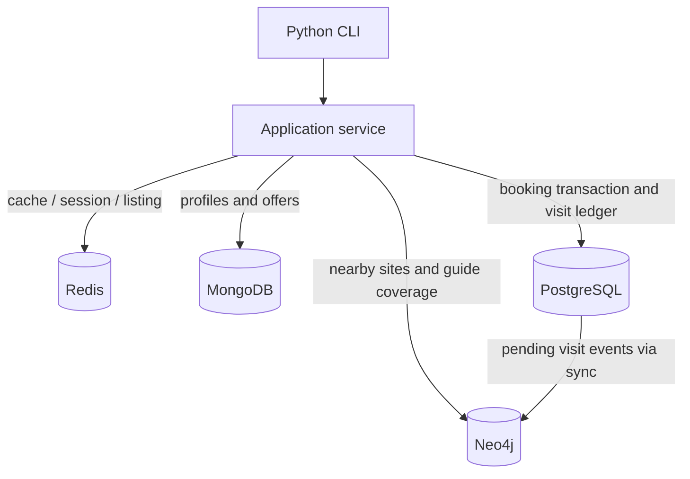

# معمارية التشغيل

**قراءة الصفحة.** يفحص التطبيق Redis أولًا. عند غياب الصفحة يجمع مستند الموقع والجولات والإقامات، ثم يجتاز علاقات القرب والتغطية، ويحسب عدد أحداث الزيارة ومتوسط التقييم مستقلين كي لا تتضاعف الصفوف. يعيد أعلى خمسة تقييمات مع نصها ويخزن الصفحة العامة 90 ثانية. إذا تعذر Redis، تظهر حالة bypass. إذا فشل مصدر أساسي أثناء تركيب الصفحة، يرجع الأمر رمز خروج غير صفري.

**كتابة الحجز.** يقرأ التطبيق العرض والموقع والمرشد من MongoDB. يسجل PostgreSQL معرّفاتها مع الحجز في معاملة واحدة محلية. قد يتغير الكتالوج بين التحقق والكتابة. تتعامل النسخة الصفية مع كتالوج ثابت وتمنع مسارات الحذف العامة، ويفحص audit المراجع.

**اكتمال الزيارة.** يقفل التطبيق صف الحجز ثم يحدّث الحالة ويسجل حدثًا فريدًا داخل المعاملة نفسها. بعد الالتزام يبطل صفحة الموقع ويسقط الحدث على علاقة VISITED. يكتب sync آخر تاريخ معروف على العلاقة باستخدام MERGE. علامة projected في سجل SQL تسمح بإعادة المحاولة بعد تعطل الشبكة أو بعد كتابة الرسم وقبل تحديث العلامة. الزيارات المتكررة إلى الموقع تُحفظ كلها في SQL.

**حدود الفشل.** قد يتأخر ظهور العلاقة حتى تشغيل sync. وإذا تعذّر الوصول إلى Redis أثناء الإبطال ثم عاد وبقيت نسخته القديمة، تنتهي صلاحيتها خلال 90 ثانية. رقم الجيل يمنع قارئًا بدأ قبل تعديل ناجح من إعادة تخزين نسخة سبق إبطالها. يتم إصلاح إسقاط زائر مسجل بتشغيل sync أيضًا.
